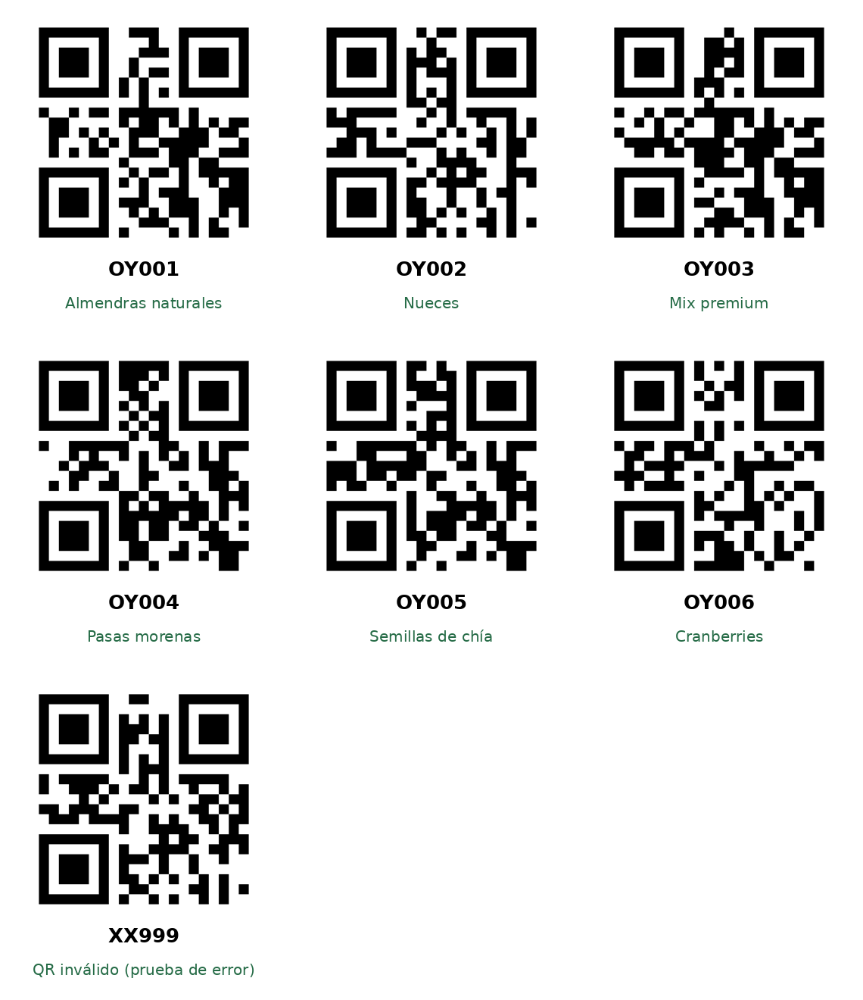

# QR de prueba

Códigos para probar el escáner (pantalla **Escáner QR**).

| Código | Resultado esperado |
|---|---|
| OY001 | Almendras naturales |
| OY002 | Nueces |
| OY003 | Mix premium |
| OY004 | Pasas morenas |
| OY005 | Semillas de chía |
| OY006 | Cranberries |
| XX999 | Inválido: "No corresponde a un producto local" |

**Antes de escanear:** abrir el Catálogo una vez para que se carguen los productos.
Requiere un dispositivo o emulador con Google Play Services.